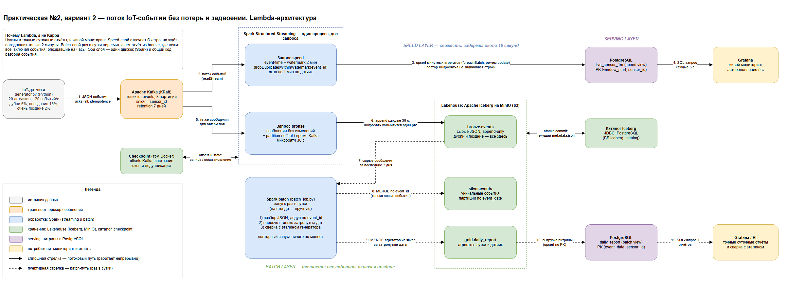

# Отчёт по практической №2

---

## 1. Вариант и задача

| Поле | Значение |
|---|---|
| ФИО (как в VK Education) | Писков Макар Евгеньевич |
| Тема | 2 — Streaming vs Batch: поток событий без потерь и задвоений |
| Состав решения | Генератор IoT-событий (Python) → Apache Kafka → Spark Structured Streaming (два запроса: bronze и speed) → Lakehouse (Apache Iceberg на MinIO, каталог в PostgreSQL) → Spark batch (silver, gold) → PostgreSQL (витрины) → Grafana. Архитектура — Lambda. |
| Данные, объём | Телеметрия 20 датчиков: `event_id`, `sensor_id`, `event_time`, `temperature`, `humidity` (JSON, ~150 байт). 20 событий/с ≈ 1,7 млн событий в сутки (~0,25 ГБ сырого JSON). В потоке специально: 5% дублей, 15% событий с опозданием 5–90 с, 2% с опозданием 5–30 мин. За проверочный прогон на стенде — 8041 сообщение, из них 7645 уникальных событий. |

## 2. Источники и способы сбора

| Источник | Тип | Способ сбора |
|---|---|---|
| IoT-датчики (на стенде — `generator/generator.py`) | поток | Продюсер пишет JSON в топик Kafka `iot.events`, ключ — `sensor_id` (события одного датчика попадают в одну партицию и сохраняют порядок записи). `acks=all` + `enable.idempotence`: брокер подтверждает запись, а сетевой ретрай продюсера не создаёт копию. Kafka нужна как буфер: датчики не зависят от скорости обработки, а сообщения хранятся 7 дней и их можно перечитать. |
| Топик Kafka `iot.events` | поток | Spark Structured Streaming, `readStream` по подписке на топик. Offsets хранятся не в Kafka, а в checkpoint самого Spark — после падения чтение продолжается с того же места. Топик читают два независимых запроса: один сохраняет всё сырьём, второй считает живые агрегаты. |
| Таблица Iceberg `bronze.events` | batch | Spark batch раз в сутки читает сырые сообщения, пришедшие за последние 2 дня (фильтр по времени прихода в Kafka, а не по времени события — поэтому в выборку попадают и сильно опоздавшие события). |
| Эталон генератора `generator_control` | batch (служебный) | Генератор сам считает, сколько уникальных событий подтвердил брокер, и пишет счётчики в PostgreSQL. В реальной системе такого источника нет — он нужен только на стенде, чтобы было с чем сверить отчёт. На схеме не показан. |

## 3. Архитектура



Исходник: `architecture.drawio`. Цифры на стрелках совпадают с шагами в разделе 5.

### Решения по вопросам варианта

**Lambda или Kappa.** Выбрана Lambda. Бизнесу нужны два результата с разными требованиями: мониторинг — быстро, суточный отчёт — точно. Потоковая обработка не может ждать опоздавших бесконечно: чем дольше ждёшь, тем больше состояния держишь в памяти и тем позже отдаёшь результат. Поэтому speed-слой ждёт 2 минуты и отдаёт цифры через ~10 секунд, а batch-слой раз в сутки пересчитывает отчёт из сырых данных, где лежит вообще всё. В Kappa пришлось бы либо держать огромный watermark, либо перечитывать Kafka целиком при каждом исправлении. Главный минус Lambda — два разных кода, которые расходятся, — снят тем, что оба слоя работают на одном движке (Spark) и используют одну схему и одну функцию разбора события (`spark/app/common.py`).

**Event-time или processing-time.** Event-time: окна и суточные границы считаются по полю `event_time` из самого события. Если считать по времени прихода, событие датчика, который 20 минут был без связи, попало бы не в ту минуту и, возможно, не в те сутки — отчёт был бы неверным. Время прихода (`kafka_ts`) тоже сохраняется, но используется только технически — чтобы batch понимал, какие сообщения новые.

**Поздние события.** Три уровня:
1. Опоздание до 2 минут — speed-слой принимает их сам: watermark держит окно открытым, агрегат пересчитывается и перезаписывается (режим `update`).
2. Опоздание больше 2 минут — speed-слой их отбрасывает (в логе это счётчик `late_dropped`), но они не теряются: запрос bronze пишет все сообщения без какой-либо фильтрации.
3. Batch-слой берёт из bronze всё, что пришло за последние 2 дня, и пересчитывает только те даты, которых коснулись новые события. Окно в 2 дня при ежедневном запуске даёт перекрытие: если один запуск пропущен, следующий подберёт его данные.

**Дубли.** Тоже несколько уровней, потому что дубль может появиться в разных местах:
- на входе в Kafka — idempotent producer (ретрай продюсера не создаёт копию);
- при чтении — offsets в checkpoint, а приёмники идемпотентны: Iceberg коммитит каждый микробатч один раз, PostgreSQL принимает upsert по первичному ключу. Повтор микробатча после сбоя ничего не задваивает;
- дубли от самого источника (датчик отправил событие дважды) — в speed-слое `dropDuplicatesWithinWatermark(event_id)`, в batch-слое `row_number()` внутри пачки и `MERGE ... WHEN NOT MATCHED` по `event_id` относительно уже загруженного.

Альтернативы, которые рассматривались: транзакции Kafka (exactly-once внутри Kafka, но приёмник здесь не Kafka, поэтому не помогает) и дедупликация только в batch (проще, но тогда живой мониторинг завышал бы цифры на 5%).

**Движок.** Spark Structured Streaming. Flink дал бы меньшую задержку, но здесь мониторингу достаточно 10 секунд, а Spark позволяет писать потоковую и пакетную часть на одном API и делить между ними код.

**Куда приземлены данные.** Сырые и очищенные данные — в Lakehouse: Apache Iceberg на MinIO, слои bronze / silver / gold. Iceberg даёт атомарные коммиты и `MERGE`, без которых не сделать идемпотентную загрузку. Готовые витрины — в PostgreSQL: их мало, они нужны для быстрых запросов Grafana, и там удобен upsert.

## 4. Docker — что поднялось (честно)

| Блок | Статус |
|---|---|
| Генератор IoT-событий (`generator`) | реализовано |
| Apache Kafka, топик `iot.events` (`kafka`, `kafka-init`) | реализовано (один брокер, replication factor 1 — отказ брокера не проверялся) |
| Spark Structured Streaming: запрос bronze | реализовано |
| Spark Structured Streaming: запрос speed | реализовано |
| Checkpoint | реализовано (том Docker `checkpoints`) |
| Lakehouse: Iceberg на MinIO (`minio`) | реализовано, но не на официальном образе — см. ниже |
| Каталог Iceberg | реализовано как JDBC-каталог в PostgreSQL. Lakekeeper и Trino не поднимались |
| Spark batch (`spark-batch`) | реализовано, но запускается вручную. Планировщика (Airflow / cron) нет |
| PostgreSQL: `live_sensor_1m`, `daily_report` (`postgres`) | реализовано |
| Grafana: мониторинг и отчёт (`grafana`) | реализовано, дашборд создаётся автоматически |

### Как запускалось

```bash
# 1. Поднять стенд (первый запуск качает ~1,3 ГБ образов; у меня это заняло около 40 минут)
docker compose up -d --build

# 2. Проверить, что поток идёт
docker compose logs --tail 5 generator
docker compose logs spark-stream | grep -E "\[speed\]|\[bronze\]"

# 3. Имитация аварии: убить Spark посреди работы и поднять снова
docker compose kill -s SIGKILL spark-stream
docker compose up -d spark-stream

# 4. Остановить генератор и подождать ~1 минуту, чтобы поток дочитал Kafka
docker compose stop generator

# 5. Суточный batch + сверка (второй запуск — проверка, что повтор ничего не меняет)
docker compose run --rm spark-batch
docker compose run --rm spark-batch

# 6. Снова включить генератор
docker compose start generator
```

Интерфейсы: Grafana — http://localhost:3001, консоль MinIO — http://localhost:9001 (minio / minio12345), Spark UI — http://localhost:4040.

### `docker ps`

```text
NAMES                       IMAGE                             STATUS                    PORTS
iot-lambda-spark-stream-1   iot-lambda-spark:latest           Up 4 minutes              0.0.0.0:4040->4040/tcp
iot-lambda-generator-1      iot-lambda-generator              Up 21 seconds
iot-lambda-grafana-1        grafana/grafana:11.2.2            Up 12 minutes             0.0.0.0:3001->3000/tcp
iot-lambda-postgres-1       postgres:16-alpine                Up 12 minutes (healthy)   0.0.0.0:5433->5432/tcp
iot-lambda-kafka-1          apache/kafka:3.8.0                Up 12 minutes (healthy)   9092/tcp
iot-lambda-minio-1          cgr.dev/chainguard/minio:latest   Up 12 minutes             0.0.0.0:9001->9001/tcp
```

`kafka-init` в списке нет — это одноразовый контейнер, он создал топик и завершился с кодом 0. `spark-batch` тоже не висит постоянно: запускается, отрабатывает и удаляется. `spark-stream` и `generator` моложе остальных, потому что я их перезапускал во время проверок.

Потребление памяти (`docker stats`): Spark ≈ 1,0 ГБ, Kafka ≈ 390 МБ, MinIO ≈ 97 МБ, Grafana ≈ 52 МБ, PostgreSQL ≈ 45 МБ, генератор ≈ 10 МБ — всего около 1,6 ГБ.

### Вывод: поток

```text
generator-1     | generator started: rate=20.0/s sensors=20 dup=0.05 delayed=0.15 very_late=0.02
spark-stream-1  | bucket lake created
spark-stream-1  | [speed] batch=12 input=211 watermark=2026-11-26T16:06:29.866Z late_dropped=5 dup_dropped=11
spark-stream-1  | [bronze] batch=4 input=376
spark-stream-1  | [speed] batch=15 input=210 watermark=2026-11-26T16:06:59.952Z late_dropped=5 dup_dropped=13
spark-stream-1  | [bronze] batch=5 input=631
```

`late_dropped` — события, опоздавшие за watermark (speed их не учитывает), `dup_dropped` — отброшенные дубли.

### Вывод: сверка после остановки генератора

```text
generator-1  | generator stopped: unique=2175, not confirmed=0, failed=0

$ kafka-get-offsets.sh --topic iot.events
iot.events:0:2390
iot.events:1:2897
iot.events:2:2754          # в сумме 8041

$ docker compose run --rm spark-batch
bronze rows in lookback window: 8041, unique events: 7645, affected dates: ['2026-11-26']
================ СВЕРКА ================
bronze, всего сообщений (с дублями): 8041
дата          эталон уник.  отправлено    silver      gold     speed  итог
2026-11-26            7645        8041      7645      7645      7498  OK
speed < эталона — это нормально: streaming не учитывает события, опоздавшие за watermark.
```

Что видно:
- **Потерь нет:** в Kafka 8041 сообщение, в bronze 8041 — хотя между ними Spark один раз был убит через `SIGKILL` и один раз пересоздан.
- **Задвоений нет:** в silver и в суточном отчёте 7645 событий — ровно столько уникальных отправил генератор; 396 дублей отфильтрованы.
- **Speed показывает меньше (7498):** разница в 147 событий — это опоздавшие больше чем на 2 минуты. Это ожидаемое поведение, ради него и нужен batch-слой.
- **Повторный запуск batch** на тех же данных дал те же 7645 / 7645.

Скриншот дашборда — `screenshots/grafana.png`. Он снят уже после того, как генератор был включён обратно, поэтому в панели сверки batch-отчёт (7645) меньше эталона: новые события попадут в отчёт при следующем запуске batch. Провалы на графике «событий в минуту» — это моменты, когда я останавливал генератор, а скачки температуры — его перезапуски (базовая температура датчиков выбирается заново).

### Что не получилось и что не сделано

- **MinIO.** Первый запуск упал: `pull access denied for minio/minio`. Официальные образы MinIO больше не публикуются ни на Docker Hub, ни на quay.io. Заменил на сборку MinIO от Chainguard (`cgr.dev/chainguard/minio`). В ней нет shell и утилиты `mc`, поэтому у контейнера нет healthcheck, а бакет `lake` создаёт сама Spark-задача при старте (`ensure_bucket` в `common.py`). Создавать инфраструктуру из кода обработки — не лучшая практика, это компромисс стенда.
- **Batch без расписания.** На схеме написано «раз в сутки», на стенде запуск ручной. Airflow не поднимал, чтобы не утяжелять стенд.
- **Проверка без генератора.** Если запустить batch при работающем генераторе, сверка честно показывает «в пути N» — последние события ещё лежат в Kafka. Точное равенство получается только после остановки генератора.
- **Не проверено:** падение брокера Kafka (он один), работа через границу суток, события, опоздавшие больше чем на 2 дня при пропущенных запусках batch.
- **Не сделано:** компактизация bronze. Коммит каждые 30 секунд порождает много мелких файлов; в реальной системе нужен регулярный `rewrite_data_files`.
- Spark работает в режиме `local[2]` в одном контейнере, без кластера.

## 5. Описание

| Шаг | Для чего | Результат |
|---|---|---|
| 1. Датчики → Kafka | Принять события надёжно и не зависеть от скорости обработки | Сообщения в топике `iot.events` (3 партиции). В потоке есть дубли и события вразнобой — на этом этапе они не исправляются |
| 2. Kafka → запрос speed | Посчитать живые показатели. Время берётся из события, watermark 2 мин, дубли по `event_id` отбрасываются | Агрегаты по минутным окнам на каждый датчик: количество, средняя / мин / макс температура |
| 3. Запрос speed → PostgreSQL | Отдать агрегаты так, чтобы повтор микробатча ничего не испортил | Таблица `live_sensor_1m`; строка окна перезаписывается upsert-ом, когда в окно приходит опоздавшее событие |
| 4. PostgreSQL → Grafana | Живой мониторинг | Графики с задержкой около 10 секунд, обновление каждые 5 с |
| 5. Kafka → запрос bronze | Параллельно сохранить всё как есть, ничего не отбрасывая | Те же сообщения плюс партиция, offset и время прихода в Kafka |
| 6. Запрос bronze → Iceberg | Получить неизменяемую копию сырых данных — источник правды для пересчётов | Таблица `bronze.events`: все сообщения, включая дубли и сколь угодно поздние |
| 7. bronze → Spark batch | Раз в сутки взять всё, что пришло за последние 2 дня | Пачка сырых сообщений; из неё выбираются уникальные `event_id` |
| 8. Spark batch → silver | Убрать дубли и относительно уже загруженного: `MERGE` вставляет только новые `event_id` | Таблица `silver.events`: каждое событие ровно один раз, партиции по дате события |
| 9. Spark batch → gold | Пересчитать суточные агрегаты только за те даты, куда попали новые события | Таблица `gold.daily_report`: сутки × датчик |
| 10. gold → PostgreSQL | Отдать готовую витрину туда, откуда её удобно читать | Таблица `daily_report` (upsert по дате и датчику) |
| 11. PostgreSQL → отчёты | Точный суточный отчёт и сверка | Таблицы в Grafana: отчёт по датчикам и сравнение «отправлено / в отчёте / в мониторинге» |

К чему шли: мониторинг видит данные почти сразу, но может недосчитать сильно опоздавшие события; суточный отчёт появляется позже, зато сходится с источником до единицы.

## 6. Выводы

- «Без потерь и задвоений» не решается одной настройкой. Это цепочка: надёжная запись в Kafka, offsets в checkpoint, идемпотентные приёмники и отдельная дедупликация по `event_id`, потому что дубли приходят и от самого источника.
- Watermark — это всегда компромисс между скоростью и полнотой. На стенде при watermark 2 минуты мониторинг недосчитал 147 событий из 7645 (около 2%). Для мониторинга это приемлемо, для отчёта — нет, поэтому отчёт считает batch-слой.
- Сырые данные стоит сохранять до любой обработки. Именно bronze позволил пересчитать отчёт точно и пережить падение Spark без потерь.
- Сверка с источником оказалась полезнее, чем ожидалось: она сразу показала, что при работающем генераторе цифры не обязаны совпадать, и заставила разделить «расхождение» и «данные ещё в пути».

**Обратная связь по заданию:**

- Формат «собери блоки в одну архитектуру и честно опиши, что поднялось» полезнее отдельных лаб: проблемы появляются именно на стыках (кто создаёт бакет, где хранить offsets, как сверить результат).
- В задании и вариантах рекомендован MinIO, но официальные образы `minio/minio` сейчас недоступны ни на Docker Hub, ни на quay.io. Стоит добавить в материалы рабочий образ или альтернативу — на поиск замены ушло заметное время.
- Было бы удобно, если бы в форме отчёта было отдельное место под ответы на вопросы варианта (Lambda или Kappa, event-time и т. д.) — сейчас они не ложатся ни в один раздел, я поместил их в раздел 3.
